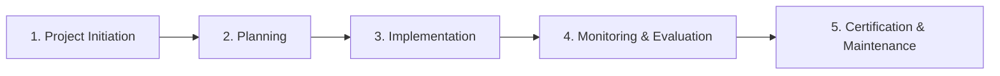

## The Full ISO 27001 Roadmap: Every Activity, Initiation to Certification + Case Study

*The map before the trip.*

Now that the fundamentals are out of the way, what ISO 27001 is, what an ISMS actually covers, it is worth taking a step back before diving into the build itself. This post gives a brief tour of the full journey ahead: every activity between deciding to pursue certification and receiving the certificate, grouped into five phases, illustrated through our running case study, **MK Consults**.

Treat this as the map before the trip. We will go deep on each phase, one at a time, as the series progresses.

Before we get there, meet the organization we will be following through that journey.

## Case Study: MK Consults

*Disclaimer: MK Consults is a fictitious company. All names, documents, and artifacts referenced throughout this series are illustrative and created for educational purposes only.*

### Company Overview

- **Name:** MK Consults
- **Headquarters:** Berlin, Germany
- **Operating model:** Remote-first
- **Industry:** Consulting and Information Security Implementation
- **Headcount:** 50 employees
- **Objective:** Implement an Information Security Management System (ISMS) aligned to ISO/IEC 27001:2022 and achieve certification

### Background

MK Consults is a growing advisory firm specializing in helping organizations implement and certify against information security and regulatory standards. Despite years advising clients on ISO 27001, the firm has not yet certified itself, a gap this series closes. Headquartered in Berlin with a remote-first operating model, the firm serves a diverse client portfolio spanning government agencies, financial institutions, and multinational corporations. Given the nature of its advisory work, MK Consults processes sensitive client data and safeguards material internal intellectual property, including proprietary methodologies and assessment frameworks, placing confidentiality, integrity, and availability obligations squarely at the center of its risk profile.

**ISMS objectives:**

- Strengthen protection of sensitive client and internal information
- Satisfy client-driven and regulatory compliance requirements
- Reinforce market positioning and competitive differentiation through independent certification

With MK Consults in view, here is the full path from initiation to certification.

## 1. Project Initiation

1. **Conduct Initial Gap Analysis** - find out where the organization stands against ISO/IEC 27001:2022 today: a high-level assessment against the mandatory requirements of Clauses 4 to 10 and a quick pass through the 93 Annex A controls, based mainly on interviews. It is done before anyone commits time or money, and produces a short readiness summary showing the effort, people, cost and timeline needed to reach certification.
2. **Conduct Management Awareness Session** - present the business case to leadership: why the organization is implementing ISO 27001, what it will cost, what it will require of them, and the approval being asked for.
3. **Secure Management Commitment** - the CEO signs a formal commitment statement and allocates resources: budget, time, and people.
4. **Initiate ISMS Project** - formally authorize the project through a project charter signed by the CEO, appointing the ISMS Project Manager and the implementation team.
5. **Understand Organization Context** - identify the internal and external issues that shape the ISMS, the interested parties (such as clients, regulators and staff) and their requirements, and which of those requirements the ISMS will address.
6. **Define ISMS Scope** - determine what is in and what is out: which people, systems, and locations the ISMS covers.

## 2. Planning

1. **Conduct Detailed Gap Assessment** - with the scope now approved, revisit the initial findings in depth: test current practices against Clauses 4 to 10 with evidence, and capture which Annex A controls are already operating. The result is a reliable baseline for the risk assessment.
2. **Develop Risk Management Process** - agree the risk methodology in advance: how risk will be identified, scored, and treated, and the criteria for accepting it, before it is applied to anything real.
3. **Conduct Risk Assessment** - build an inventory of the organization's information and the assets that hold it, then apply the methodology to identify, analyze, and evaluate the risks to them, taking account of the controls already in place.
4. **Develop Statement of Applicability** - determine the controls needed to treat the risks, cross-check them against Annex A so that none are missed, and record for each Annex A control whether it applies, why, and whether it is implemented.
5. **Develop Risk Treatment Plan** - set out how each risk will be treated, who owns it, what resources it needs and by when. Risk owners approve the plan and formally accept the risks that remain.
6. **Set Information Security Objectives** - define measurable objectives for the ISMS, with an owner, the resources needed, a target date, and how results will be evaluated.

## 3. Implementation

1. **Develop Information Security Policies** - draft the policy suite that sets the rules, top down, for how the organization protects information.
2. **Develop Supporting Procedures** - translate those policies into the step by step guidance that people follow in practice.
3. **Implement Selected Controls** - put the technical and organizational controls identified in the Statement of Applicability and the risk treatment plan into effect.
4. **Conduct Awareness and Training Programs** - ensure every employee, not only the security team, understands their role in protecting information.

## 4. Monitoring & Evaluation

1. **Monitor and Measure ISMS Performance** - track the metrics and KPIs that indicate whether controls are operating effectively, not merely in place, and whether the objectives are being met.
2. **Conduct Internal Audits** - independently verify the ISMS against the standard and the organization's own documentation, ahead of the external audit. Internal auditors must not audit their own work.
3. **Conduct Management Review** - top management formally reviews ISMS performance and determines what requires change.
4. **Remediate Nonconformities** - address findings from internal audits and management review: fix the immediate issue, then remove its root cause so it does not recur.
5. **Implement Continual Improvement** - feed findings, incidents, and review outcomes back into strengthening the ISMS over time.

## 5. Certification & Maintenance

1. **Stage 1 Audit: Documentation and Readiness Review** - the certification body reviews the ISMS documentation, checks that internal audits and management reviews are planned and being performed, and assesses readiness for Stage 2. In practice, most certification bodies expect at least one full internal audit and management review, and a few months of the ISMS operating, before Stage 2.
2. **Address Stage 1 Areas of Concern** - resolve the areas of concern raised at Stage 1 ahead of the Stage 2 audit, so they do not become nonconformities.
3. **Stage 2 Audit: Evidence-Based Implementation Audit** - the certification body interviews staff, samples records and tests controls to confirm the ISMS is implemented and operating effectively in practice.
4. **Remediate Nonconformities** - close out any major nonconformities and agree corrective action plans for minor ones. Once the certification body has accepted them, it makes its certification decision.
5. **Maintain Certification** - keep the ISMS running and improving, pass the surveillance audits (at least once a year, the first within 12 months of certification), and complete a recertification audit before the three-year certificate expires.

## Where we go from here

Five phases, twenty-six activities, one continuous line from initiation to certification, and now a company to follow through it. The next post starts Phase 1 with its first activity: the initial gap analysis, which tells us where MK Consults actually stands against the standard.

Thanks for reading, see you in the next post.

**Mawumefa**
*Your Audit Ally*

*MK Consults is a fictitious company. All names, figures and documents in this series are illustrative and created for educational purposes.*

## Sources

- [ISO/IEC 27001:2022, Information security management systems: Requirements](https://www.iso.org/standard/27001)
- [ISO/IEC 27002:2022, Information security controls](https://www.iso.org/standard/75652.html)
- [ISO/IEC 27000:2026, Information security management systems: Overview and vocabulary](https://www.iso.org/standard/84257.html)
- [ISO/IEC 27001 explained (ISO)](https://www.iso.org/isoiec-27001-information-security.html)
